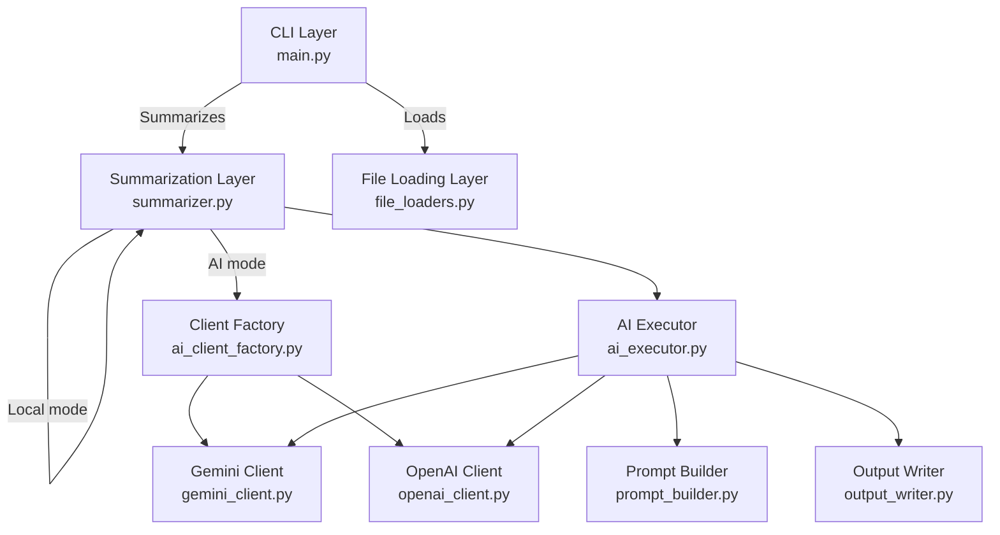
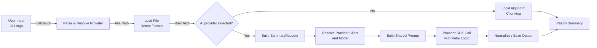

# Technical Documentation - Docalyzer

**Architecture, design decisions, and implementation details for developers**

##  Architecture Overview

Docalyzer now uses a provider-based AI architecture while preserving local summarization as the default path.



### Layer Responsibilities

1. **CLI Layer** (`main.py`): Argument parsing, validation, provider resolution, orchestration
2. **Summarization Layer** (`summarizer.py`): Local fallback vs. AI routing
3. **Client Factory** (`ai_client_factory.py`): Provider-specific client creation and model resolution
4. **AI Executor** (`ai_executor.py`): Provider-neutral AI request execution
5. **Prompt Builder** (`prompt_builder.py`): Shared prompt construction for all providers
6. **Output Writer** (`output_writer.py`): Shared file output and JSON normalization
7. **Provider Clients** (`gemini_client.py`, `openai_client.py`): SDK integration, retries, provider error translation
8. **File Loading** (`file_loaders.py`): Multi-format document parsing

##  Module Design

### 1. Main Module (`src/docalyzer/main.py`)

**Responsibility**: CLI entry point and orchestration

```python
def build_parser() -> argparse.ArgumentParser:
    """Create CLI argument parser"""


def main() -> int:
    """Parse args → Load file → Summarize → Print output"""
```

**CLI Arguments**:
- `path` (required): File to summarize
- `--provider` (optional): AI provider (`gemini`, `openai`)
- `--gemini` (optional flag): Deprecated compatibility alias for `--provider gemini`
- `--sentences` (optional, default 5 in AI mode): AI summary length
- `--model` (optional, default `mid` in AI mode): Provider-neutral effort level (`low`, `mid`, `high`)
- `--desc_level` (optional, default `2` in AI mode): Description depth (`1`, `2`, `3`)
- `--sum_level` (optional, default `2` in AI mode): Summary richness (`1`, `2`, `3`)
- `--output` (optional, default `txt`): Output format (`txt`, `md`, `json`)
- `--tofile` (optional): Save AI output to a user-provided file path

**Return codes**:
- `0`: Success
- `1`: Validation, file loading, or summarization error
- `2`: `argparse` usage error for invalid enum values or malformed CLI input

**Design Decisions**:
- No provider selected means local summarization
- `--provider` enables AI mode
- `--gemini` is preserved as a backward-compatible alias
- CLI resolves provider conflicts early before any provider-specific logic runs
- `main.py` bootstraps the local `src/` path when run directly so `python3 src/docalyzer/main.py ...` and `python3 main_shortcut.py ...` use the same in-repo code instead of a stale installed package copy

**Validation rules**:
- `--sentences`, `--model`, `--desc_level`, `--sum_level`, `--tofile`, and non-default AI output formats require AI mode
- `--sentences` must be between `1` and `250`
- `--desc_level` must be between `1` and `3`
- `--sum_level` must be between `1` and `3`
- `--gemini` cannot be combined with a non-Gemini provider

### 2. Summarizer Module (`src/docalyzer/summarizer.py`)

**Responsibility**: Summarization algorithm selection and execution

```python
def summarize_text(text: str, max_sentences: int = 5) -> str:
    """Extract sentences from text, return first N"""


def summarize_long_text(
    text: str,
    model_kind: ModelEnum | None = None,
    chunk_size: int = 2000,
    max_sentences: int = 5,
    use_gemini: bool = False,
    provider: ProviderEnum | None = None,
    output_format: OutputEnum = OutputEnum.PLAIN,
    tofile_path: Path | None = None,
    description_level: int = 2,
    summary_level: int = 2,
) -> str:
    """Route to local summarization or provider-based AI execution"""
```

**Local Summarization Algorithm**:
1. Split text into fixed-size chunks (`2000` characters)
2. Extract sentences from each chunk
3. Return the first N sentences per chunk
4. Join chunk summaries with double newlines

**AI Routing Flow**:
1. Resolve legacy `use_gemini` into `ProviderEnum.GEMINI` when needed
2. Build a provider-neutral `SummaryRequest`
3. Create a provider client through `create_ai_client()`
4. Execute the request through `AIExecutor`
5. Return a provider-specific user-facing error string on failure

**Design Decision**:
- Keep `use_gemini` temporarily for backward compatibility
- Make `provider` the canonical internal AI switch
- Keep local summarization entirely independent from provider integrations

### 3. Provider Enum Module (`src/docalyzer/provider_enum.py`)

**Responsibility**: Define the supported AI providers exposed to the CLI and internal factory logic.

```python
class ProviderEnum(StrEnum):
    GEMINI = "gemini"
    OPENAI = "openai"
```

**Design Decision**:
- Use provider names, not model family nicknames, as the CLI contract
- Expose a `display_name` property for consistent user-facing error messages

### 4. Model Selection Module (`src/docalyzer/model_enum.py`)

**Responsibility**: Keep CLI model selection stable while allowing provider-specific concrete models to vary internally.

```python
class ModelEnum(StrEnum):
    LOW = "low"
    MID = "mid"
    HIGH = "high"
```

**Gemini mapping**:
- `low` → `gemini-2.5-flash-lite`
- `mid` → `gemini-2.5-flash`
- `high` → `gemini-2.5-pro`

**OpenAI mapping**:
- `low` → `gpt-4.1-mini`
- `mid` → `gpt-4.1`
- `high` → `gpt-5.2`

**Design Decision**:
- Keep the CLI provider-neutral with `low|mid|high`
- Let the factory resolve those effort levels into provider-specific model IDs

### 5. AI Request Types (`src/docalyzer/ai_types.py`)

**Responsibility**: Define provider-neutral request and client contracts.

```python
@dataclass(slots=True)
class SummaryRequest:
    text: str
    max_sentences: int = 5
    output_format: OutputEnum = OutputEnum.PLAIN
    tofile_path: Path | None = None
    description_level: int = 2
    summary_level: int = 2


class AIClient(Protocol):
    def summarize_request(self, request: SummaryRequest) -> str:
        ...
```

**Design Decision**:
- Use a dataclass to reduce keyword drift and silent argument mismatches
- Use a protocol so Gemini and OpenAI can share a common executor path

### 6. AI Error Types (`src/docalyzer/ai_errors.py`)

**Responsibility**: Normalize provider-specific failures into shared app-level categories.

```python
class AIError(RuntimeError):
    ...

class AIConfigurationError(ValueError, AIError):
    ...

class AISummarizationError(AIError):
    ...
```

**Design Decision**:
- `AIConfigurationError` subclasses `ValueError` to preserve compatibility with older tests and call sites
- Provider-specific errors such as `GeminiAPIError` and `OpenAIAPIError` subclass `AISummarizationError`

### 7. Prompt Builder (`src/docalyzer/prompt_builder.py`)

**Responsibility**: Build shared prompts for all providers based on output format and detail controls.

**Inputs**:
- `text`
- `output_format`
- `max_sentences`
- `description_level`
- `summary_level`

**Behavior**:
- Builds different prompt bodies for `txt`, `md`, and `json`
- Applies `DESCRIPTION_LEVEL_TO_PROMPT`
- Applies `SUMMARY_LEVEL_TO_PROMPT`
- Preserves the existing JSON response contract
- Falls back defensively to plain-text instructions for unknown output values

**Design Decision**:
- Centralize prompt logic outside provider clients so provider behavior stays aligned
- Avoid prompt drift between Gemini and OpenAI

### 8. Output Writer (`src/docalyzer/output_writer.py`)

**Responsibility**: Provider-neutral output normalization and file writing.

**Key features**:
- append the selected file extension if the user omits one
- reject mismatched file extensions
- normalize JSON by stripping code fences and pretty-printing valid JSON
- keep invalid JSON as cleaned raw text rather than crashing

**Design Decision**:
- File output is not provider-specific, so it should not live in provider clients

### 9. AI Executor (`src/docalyzer/ai_executor.py`)

**Responsibility**: Execute provider-neutral `SummaryRequest` instances through any `AIClient` implementation.

```python
class AIExecutor:
    def __init__(self, client: AIClient) -> None:
        self.client = client

    def summarize(self, request: SummaryRequest) -> str:
        return self.client.summarize_request(request)
```

**Design Decision**:
- Keep orchestration provider-neutral even if the implementation is intentionally lightweight today
- Preserve an obvious extension point for future provider-neutral behaviors

### 10. AI Client Factory (`src/docalyzer/ai_client_factory.py`)

**Responsibility**: Resolve provider/model combinations and construct the appropriate client.

```python
def resolve_model_name(
    provider: ProviderEnum,
    model_kind: ModelEnum | None = None,
) -> str:
    ...


def create_ai_client(
    provider: ProviderEnum,
    model_kind: ModelEnum | None = None,
) -> AIClient:
    ...
```

**Behavior**:
- maps `low|mid|high` to provider-specific model IDs
- returns `GeminiClient.from_env(...)` or `OpenAIClient.from_env(...)`
- lets provider-specific env defaults apply when no explicit `--model` kind is chosen
- keeps provider branching centralized in one place

**Design Decision**:
- Avoid spreading `if provider == ...` branching across the CLI, summarizer, and executor

### 11. Gemini Client (`src/docalyzer/gemini_client.py`)

**Responsibility**: Gemini SDK integration, environment loading, retries, and Gemini-specific error translation.

**Key features**:
- lazy imports for `google-genai`
- `.env` and environment loading with `GEMINI_API_KEY`, `GEMINI_MODEL`, `GEMINI_MAX_RETRIES`
- provider-specific retry handling around Gemini errors
- compatibility methods preserved:
  - `summarize(...)`
  - `_format_request(...)`
  - `_write_to_file(...)`
  - `_normalize_output_content(...)`

**Design Decision**:
- Keep the Gemini-specific client class stable while delegating prompt construction and file writing to shared helpers

### 12. OpenAI Client (`src/docalyzer/openai_client.py`)

**Responsibility**: OpenAI SDK integration, environment loading, retries, and OpenAI-specific error translation.

**Environment variables**:
- `OPENAI_API_KEY`
- `OPENAI_MODEL`
- `OPENAI_MAX_RETRIES`

**Key features**:
- lazy import for the `openai` SDK
- retry support for rate limits, timeouts, connection failures, retryable `429` status errors, and retryable `5xx` API status errors
- non-retryable `4xx` API status errors are raised immediately as `OpenAIAPIError`
- response extraction from `response.output_text` with defensive fallbacks to `choices[0].text` and `choices[0].message.content`
- shared prompt-building and output-writing behavior with Gemini

**Design Decision**:
- Match the Gemini contract closely so both providers fit the same executor and request flow

### 13. File Loaders Module (`src/docalyzer/file_loaders.py`)

**Responsibility**: Multi-format document parsing

**Supported Formats**:

| Category | Extensions |
|----------|-----------|
| Documents | `.pdf`, `.docx`, `.xlsx`, `.pptx` |
| Markup | `.html`, `.xml`, `.md`, `.json`, `.yaml`, `.yml` |
| Data | `.csv` |
| Code | `.py`, `.js`, `.ts`, `.go`, `.java`, `.c`, `.cpp` |
| Text | `.txt` |

##  Data Flow Diagram



##  Testing Strategy

### Test Coverage

```
tests/
├── test_ai_client_factory.py
├── test_ai_executor.py
├── test_file_loaders.py
├── test_gemini_client.py
├── test_main.py
├── test_model_enum.py
├── test_openai_client.py
├── test_shared_ai_components.py
└── test_summarizer.py
```

### Current coverage areas

- CLI validation for local mode vs. AI provider mode
- backward-compatible `--gemini` alias handling
- provider/model resolution through the client factory
- lightweight executor delegation and runtime protocol compatibility checks
- shared prompt builder behavior and output writer normalization/file writing
- summarizer routing for local, Gemini, and OpenAI execution
- Gemini and OpenAI environment loading and retry behavior
- OpenAI-specific response extraction fallbacks and retry/non-retry status handling
- file loader behavior for supported formats and failure cases

##  Key Design Tradeoffs

| Decision | Rationale | Tradeoff |
|----------|-----------|----------|
| No provider selected means local mode | Keeps local summarization simple and explicit | AI options need validation gates |
| Keep `--gemini` as alias | Preserves compatibility while migrating to `--provider` | Temporary CLI redundancy |
| Shared prompt builder | Prevents provider drift | Slightly more indirection |
| Shared output writer | Avoids duplicate file handling logic | Provider clients are a little thinner |
| Provider-neutral request dataclass | Reduces keyword mismatch risk | One more abstraction layer |
| Factory-based provider creation | Centralizes provider branching | Extra module to maintain |
| Keep provider clients separate | Allows SDK-specific retry/config logic | More files than a Gemini-only design |

##  Future Extension Points

The current architecture intentionally prepares for additional providers without forcing the entire app to become a provider framework.

Natural next steps:
- add another provider client that satisfies `AIClient`
- extend provider-specific model mappings
- factor out duplicated provider env-loading or base-client behavior if a third provider makes the common shape clearer
- add provider-specific raw model override flags if needed later
- add stronger type checking (`mypy` or `pyright`) to guard against future interface drift
